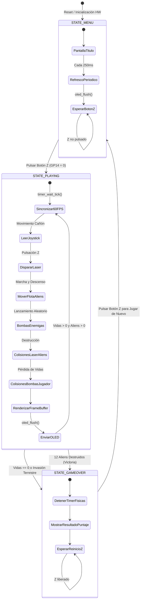

# Reporte Técnico: Videojuego Space Invaders en Ensamblador ARM Bare-Metal
**Estudiante:** Carlos  
**Curso:** Arquitectura de Computadores II  
**Plataforma de Hardware:** Raspberry Pi Pico H (Microcontrolador RP2040 - ARM Cortex-M0+)  
**Periféricos:** Pantalla OLED SH1106 128x64 I2C (1.3") y Módulo Joystick Analógico KY-023  
**Lenguaje:** 100% Ensamblador ARMv6-M Puro (`.s`) — Sin bibliotecas externas ni SDK  

---

## 1. Descripción del Proyecto

El objetivo de este proyecto es diseñar, estructurar e implementar el legendario videojuego arcade **Space Invaders** interactuando directamente con el silicio del procesador ARM Cortex-M0+ (RP2040) a nivel de registros físicos.

El sistema se ejecuta en modo **Bare-Metal** (sin sistema operativo ni bibliotecas de alto nivel). Todo el control de los periféricos (I2C por hardware, ADC de 12 bits, temporizador por hardware ALARM0, generador de reloj Watchdog y matriz de pines) ha sido desarrollado en lenguaje ensamblador modular cumpliendo con las pautas del estándar oficial **AAPCS**.

---

## 2. Esquema Electrónico y Conexionado de Hardware

### 2.1 Tabla de Conexiones Físicas

| Dispositivo | Pin del Módulo | Pin Pico H | Función en RP2040 | Descripción / Configuración |
| :--- | :--- | :--- | :--- | :--- |
| **OLED SH1106 1.3"** | **SDA** | **GP4** (Pin 6) | `I2C0 SDA` | Línea de datos I2C (Función 3 en IO_BANK0) |
| **OLED SH1106 1.3"** | **SCL** | **GP5** (Pin 7) | `I2C0 SCL` | Línea de reloj I2C (Función 3 en IO_BANK0) |
| **OLED SH1106 1.3"** | **VCC** | **3V3(OUT)** (Pin 36) | Alimentación | 3.3V DC |
| **OLED SH1106 1.3"** | **GND** | **GND** (Pin 38) | Tierra | Masa común del circuito |
| **Joystick KY-023** | **VRX** | **GP26** (Pin 31) | `ADC0` | Desplazamiento horizontal del cañón defensor |
| **Joystick KY-023** | **VRY** | **GP27** (Pin 32) | `ADC1` | Eje complementario con auto-detección |
| **Joystick KY-023** | **SW (Z)** | **GP14** (Pin 19) | `SIO GPIO14` | Disparo de láser / Botón de inicio y reinicio |
| **Joystick KY-023** | **+5V / VCC** | **3V3(OUT)** (Pin 36) | Alimentación | 3.3V DC (Referencia potenciómetros) |
| **Joystick KY-023** | **GND** | **GND** (Pin 38) | Tierra | Masa común del circuito |

### 2.2 Diagrama Esquemático

```
              +----------------------------------+
              |     Raspberry Pi Pico H (RP2040) |
              |                                  |
              |     [GP4] Pin 6  ---------------> SDA (OLED SH1106 1.3")
              |     [GP5] Pin 7  ---------------> SCL (OLED SH1106 1.3")
              |     [GP14] Pin 19 <-------------- SW  (Disparo Láser / Botón Z)
              |     [GP26] Pin 31 <-------------- VRX (Movimiento Cañón X)
              |     [GP27] Pin 32 <-------------- VRY (Eje Analógico Y)
              |     [3V3] Pin 36 ---------------> VCC (Alimentación 3.3V)
              |     [GND] Pin 38 ---------------> GND (Masa Común)
              +----------------------------------+
```

---

## 3. Mapa de Memoria del Sistema (Memory Map)

### 3.1 Distribución en Memoria Flash (ROM / XIP - Base: `0x10000000`)

```
+---------------------+ 0x10000000
| Boot Stage 2        | 256 bytes (.boot2)
| (W25Q080 QSPI Init) | Configura Flash SPI en modo Quad-Read continuo + CRC32
+---------------------+ 0x10000100
| Vector Table        | 256 bytes (.vectors)
| (Cortex-M0+ NVIC)   | Puntero inicial SP y tabla de excepciones/interrupciones
+---------------------+ 0x10000200
| .text               | Código ejecutable ARMv6-M puro
| (Módulos del juego) | system, timer, inputs, video, font, main
+---------------------+
| .rodata             | Tablas de solo lectura
| (Fuentes y Sprites) | Mapas 5x7 (font5x7_data), sprites de aliens y comandos OLED
+---------------------+
| __data_load__       | Imagen ROM de la sección .data
+---------------------+
```

### 3.2 Distribución en Memoria RAM (SRAM - Base: `0x20000000`)

```
+---------------------+ 0x20000000 (__data_start__)
| .data               | Variables con valor inicial (copiadas desde Flash en el Reset)
+---------------------+ __bss_start__
| Framebuffer Gráfico | 1024 bytes (128x64 bits = 8 páginas x 128 columnas)
| framebuffer[1024]   | Buffer de vídeo en memoria interna
+---------------------+
| Variables de Juego  | game_state, score, player_lives, winner,
| y Físicas           | player_x, laser_active, laser_x, laser_y,
|                     | fleet_x, fleet_y, fleet_dir, fleet_tick, aliens_left,
|                     | alien_alive[12], bomb_active, bomb_x, bomb_y
+---------------------+ __bss_end__
| Pila del Sistema    | Crecimiento hacia direcciones bajas (Full Descending)
| (Stack Cortex-M0+)  | Alineación obligatoria a 8 bytes según AAPCS
+---------------------+ 0x20042000 (__stack_top)
```

---

## 4. Control de Periféricos y Mapeo Directo de Registros

### 4.1 Secuencia de Arranque Seguro en Frío (Cold Boot)
1. **Oscilador de Cristal XOSC (`0x40024000`):** Se activa el cuarzo de 12 MHz con retardo de arranque en `XOSC_STARTUP` y se espera la estabilización de frecuencia (`XOSC_STATUS` bit 31).
2. **Árbol de Relojes (`CLOCKS_BASE = 0x40008000`):**
   * `CLK_REF` conmuta a XOSC (12 MHz).
   * `CLK_SYS` opera en fase con `CLK_REF` (12 MHz).
   * `CLK_PERI` se activa para alimentar el bus I2C0.
   * `CLK_ADC` se activa para alimentar la lógica de muestreo del conversor analógico.
3. **Generador de Microsegundos del Watchdog (`0x4005802C`):** Se programa `WATCHDOG_TICK = 0x020C` (12 MHz / 12 = 1.000 MHz), permitiendo que el hardware timer mida microsegundos reales.
4. **Des-reset de Periféricos (`0x4000F000`):** Se liberan de reset `IO_BANK0`, `PADS_BANK0`, `I2C0`, `ADC` y `TIMER`.
5. **Retardo de Estabilización de Pantalla:** Se ejecuta una pausa por hardware de ~100 ms para que los condensadores internos de la pantalla OLED y su circuito de Power-On Reset (POR) alcancen régimen permanente antes de recibir tráfico I2C.

### 4.2 Controlador I2C y Pantalla OLED SH1106
* `I2C0_BASE = 0x40044000` configurado a 400 kHz Fast-Mode.
* Control en doble fase: se envía la secuencia de encendido de la bomba de carga DC-DC (`0xAD, 0x8B`) con pausa intermedia de 20 ms.
* Direccionamiento por páginas (0 a 7) con offset de columna de 2 píxeles para centrado de panel en la memoria de 132 columnas del SH1106.

### 4.3 Temporizador por Hardware e Interrupciones NVIC
* El temporizador físico de 64 bits (`TIMER_BASE = 0x40054000`, `ALARM0`) dispara una interrupción periódica cada **16,666 µs (60 FPS)**.
* La interrupción `TIMER_IRQ_0` en el NVIC (`0xE000E100`) despierta al procesador mediante `wfi`, eliminando por completo retardos vacíos.

---

## 5. Máquina de Estados y Mecánicas del Videojuego



### 5.1 Reglas del Juego Implementadas
1. **Defensa Terrestre:** El jugador controla un cañón móvil en la parte inferior de la pantalla ($Y = 54$), con desplazamiento analógico fluido.
2. **Flota Invasora:** 12 aliens organizados en 2 filas de 6. Marchan horizontalmente rebotando en los laterales y descendiendo 3 píxeles hacia la Tierra cada vez que tocan un borde.
3. **Disparos del Defensor:** El botón Z dispara un láser de alta velocidad hacia arriba. Cada impacto destruye un invasor y suma 20 puntos al marcador.
4. **Ataque Alienígena:** Los invasores lanzan bombas descendentes en trayectoria vertical. Si una bomba impacta el cañón, el jugador pierde una de sus 3 vidas.
5. **Condiciones de Fin de Partida:**
   * **Victoria:** Todos los invasores (12) son destruidos $\rightarrow$ ¡Tierra a Salvo!
   * **Derrota:** El jugador agota sus 3 vidas o la flota alienígena desciende hasta la superficie ($Y \ge 42$).

---

## 6. Cálculo de Tiempos de Refresco y Rendimiento

### 6.1 Temporizador de Físicas
$$\text{Período} = \frac{1}{60\text{ Hz}} = 16,666.\bar{6}\ \mu\text{s}$$
El registro `TIMER_ALARM0` se reprograma en cada interrupción con un avance de 16,666 microsegundos.

### 6.2 Ancho de Banda y Tasa de Refresco de Pantalla
* **Datos transmitidos por cuadro:** 8 páginas $\times$ 133 bytes = 1,064 bytes $\approx$ 9,600 bits I2C.
* **Tiempo de transmisión a 400 kHz:**
$$T_{\text{frame}} \approx 9,600 \times 2.5\ \mu\text{s} = 24.0\text{ ms}$$
* **Tasa de refresco efectiva:**
$$\text{FPS} \approx \frac{1}{0.024\text{ s}} \approx 41.6\text{ FPS}$$
Al ser superior a 30 FPS, la imagen se despliega de forma continua y libre de flickering.

---

## 7. Estándar de Llamadas AAPCS y Manejo de la Pila

* Los parámetros de función se transfieren en `r0`-`r3` y los valores de retorno en `r0`.
* Se preservan estrictamente los registros `r4`-`r7` y `lr` al ingresar y salir de cada subrutina mediante `push {r4-r7, lr}` y `pop {r4-r7, pc}`.
* Las llamadas a funciones dentro de bucles críticos preservan los registros volátiles (`push {r2, r3}` antes de `fb_draw_pixel` y `pop {r2, r3}` inmediatamente después), garantizando la integridad de cada píxel dibujado.

---

## 8. Instrucciones de Compilación y Flasheo

1. Conecta la **Raspberry Pi Pico H** manteniendo presionado el botón blanco **BOOTSEL**.
2. Abre una consola en el directorio del proyecto y ejecuta:
   ```cmd
   build.bat
   ```
3. El script compilará todos los módulos `.s`, generará `space_invaders.uf2` y lo transferirá a la Pico.
4. La pantalla mostrará **"SPACE INVADERS - ARQUITECTURA II - PULSE BOTON Z"** listo para defender la Tierra.

